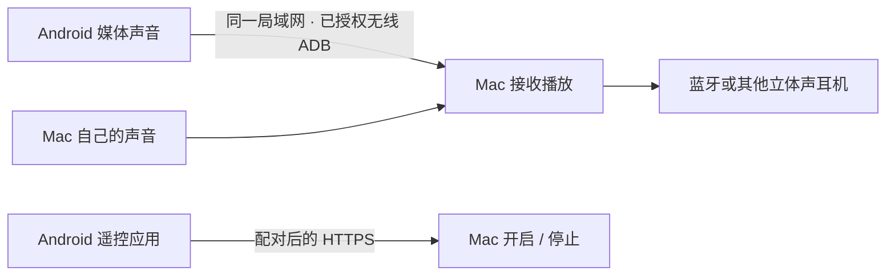

<p align="center"></p>

# 设备混音 · Device Mixer

让安卓手机的媒体声音通过 Wi-Fi 传到 Mac，与 Mac 的声音一起进入同一副耳机。

**v0.4.0 · 个人实验项目 · Apple Silicon Mac + Android**

这个项目起于一个实际需求：蓝牙耳机可以连接两台设备，但播放时往往只能听其中一路。设备混音把 Mac 作为声音汇合点：安卓声音通过已授权的无线 ADB 和 scrcpy 传到 Mac，Mac 再将两路声音一起送进耳机。它不修改耳机固件。



## 日常使用

1. 打开 Mac 的「设备混音」，选择耳机输出。
2. 手机与 Mac 位于同一可互通网络，手机无线调试保持开启。
3. **左键点 Mac 菜单栏的耳机图标**，开启混音；再点一次恢复普通使用。右键打开控制菜单。
4. 也可以在手机上的「设备混音遥控」点 **开启混音 / 恢复普通使用**。

默认是普通模式；普通模式不运行音频转发。主窗口关闭后收起到后台，退出应用会停止混音并尝试恢复设置。开启和恢复时请解锁安卓设备，以便切换耳机的媒体音频设置。

在混音期间，如果手机已经与所选耳机配对，工具会暂时关闭手机对这副耳机的「媒体音频」，避免耳机切回手机直连；同时把 Mac 默认输入暂时设为内置麦克风，保留立体声输出。停止后按记录恢复原来的设置。工具不采集麦克风，也不修改手机的通话开关。

如果设备掉线、锁屏导致恢复失败，界面会显示「设置待恢复」。重新连接并解锁后点击「恢复普通使用」。恢复记录保留在本机；Mac 声音设备恢复时会检查当前选择，避免覆盖你在混音期间手动做出的更改。

## 安装与首次设置

当前仓库提供源码及 [Android 遥控 APK](dist/DeviceMixerRemote.apk)。Mac 客户端需要按下文在本机构建，尚未提供签名、公证和通用安装发行版。

要求：

- Apple Silicon Mac，macOS 14.2 或更新版本；Xcode Command Line Tools、可用的 `/usr/bin/python3`（Python 3.9+）。
- 安卓音频转发基于 scrcpy，要求 Android 11+。Android 11 在启动音频转发时还需保持解锁。遥控 APK 的最低安装版本是 Android 8，但这不降低音频转发的系统要求。见 [scrcpy 音频文档](https://github.com/Genymobile/scrcpy/blob/v5.0/doc/audio.md)。
- 耳机作为 Mac 的可用立体声输出。手机与 Mac 的局域网连接必须互通；公共网络可能隔离设备。

先在安卓开发者选项打开「无线调试」，通过系统提供的配对码与这台 Mac 配对：

```sh
# 使用你已安装的官方 adb，或构建后应用内的 adb
adb pair <手机显示的配对地址:端口>
adb connect <手机无线调试页显示的连接地址:端口>
```

配对端口与连接端口可能不同，请以手机界面为准。小米/HyperOS 上，自动操作蓝牙设置还可能需要「USB 调试（安全设置）」的本人确认。工具不会绕过系统授权、锁屏或配对确认。无需开放传统明文 TCP 5555 端口。

Mac「刷新设备」会登记已经允许此 Mac 访问、且已连接的安卓设备。以后它们在线时会自动出现，混音模式下新接入且勾选的设备会自动开启自己的音频流。**首次系统授权仍须本人完成**。仅有 USB 授权、尚未建立无线连接的设备可以被发现，但需要先完成无线配对才能无线混音。

### 安装手机遥控器

Mac 保持普通模式，安卓设备在线，点击 **安装并配对手机端**。Mac 使用现有的 ADB 授权安装 APK，并将一次性配对信息传给手机应用，无需手动输入地址。也可以自行安装 APK，再从 Mac 复制配对链接，在手机应用内粘贴；链接 3 分钟有效且仅能使用一次。

遥控器只控制这台 Mac 的开始、停止和刷新状态。声音仍由 Mac 汇合，Mac 需要开机并运行客户端。手机应用只申请联网与网络状态权限，没有麦克风、相机或录音权限。

## 当前验证范围

| 项目 | 状态 |
| --- | --- |
| Xiaomi 15 Ultra → Wi-Fi → Mac → soundcore Space 2，同时播放手机和 Mac 媒体 | 实机试用已听到两路声音 |
| Android 遥控器安装、配对、开启、停止及状态反馈 | 实机验证 |
| 停止后手机媒体音频及 Mac 原输入/输出恢复 | 实机检查；无待恢复记录或残留 scrcpy |
| 已授权设备登记与多设备控制器结构 | 已实现；更多机型及三路同时播放尚待实测 |
| 通话、耳机麦克风、iPhone/iPad、后台免调试直传 | 当前不支持 |
| 长时间稳定性、所有网络及所有蓝牙设置布局 | 尚未全面验证 |

手机「媒体音频」自动切换目前只在上述 HyperOS 设备上实测。其他系统的设置布局可能不同；工具在无法唯一确认入口或开关状态时会停止自动点击。没有与目标耳机配对的安卓设备无需切换该设置。

Wi-Fi 传输会产生延迟，适合音乐、语音和一般媒体；尚未测量完整端到端延迟，不保证游戏、乐器监听或音画同步。默认「更稳模式」使用 200 ms 音频缓冲，可关闭后尝试 100 ms；这两个数值不是总延迟。当前 Wi-Fi 音频采用 Opus 128 kbit/s。受保护的内容以及系统不允许捕获的音频可能无法转发。

## 隐私与连接方式

- 媒体在局域网中通过已授权的 Android 无线调试连接传输；不经云服务，不保存音频文件。
- 手机遥控使用 HTTPS，并核对首次配对时保存的 Mac 证书指纹。认证令牌在手机上通过 Android Keystore 加密保存，在 Mac 上只保存其哈希。
- 遥控接口只接受开始、停止、刷新和读取状态，不能执行任意命令或读取文件。
- Mac 应用运行期间会在局域网发布发现服务并监听控制接口；普通模式仍可接收已配对手机的控制，但没有音频转发。
- ADB 调试授权可以控制设备。只给自己的可信 Mac 授权；结束使用后可在安卓无线调试设置中撤销配对或关闭无线调试。
- 设备身份、局域网地址、证书、配对凭据及恢复记录只存在 `~/Library/Application Support/Device Mixer`，不属于源码和 APK。诊断状态可能包含设备名称，不要直接公开整个数据目录。

## 本机构建

### Mac

```sh
python3 scripts/build_mac.py
# 输出：dist/设备混音.app
open 'dist/设备混音.app'
```

构建脚本从 Genymobile 官方发行页获取固定版本 scrcpy 5.0，验证固定 SHA-256，编译自己的 Swift 客户端、音频状态工具和设置识别工具，并进行本地临时签名。不需要云端 API。

如果已有经官方校验的 scrcpy 5.0 Apple Silicon 便携目录，可使用：

```sh
python3 scripts/build_mac.py --tools /path/to/scrcpy-macos-aarch64-v5.0
```

`--tools` 是供本机使用的受信任目录，脚本不会替你核验这个目录的来历。编译出来的应用使用 `/usr/bin/python3`；它不是独立捆绑 Python 的发行包。

### Android

使用 JDK 21、Android SDK Platform 35、Build Tools 36（需包含 `aapt2`、`d8.jar`、`apksigner.jar`、`zipalign`）：

```sh
python3 scripts/build_android.py \
  --jdk /path/to/jdk/Contents/Home \
  --platform /path/to/android-35/android.jar \
  --build-tools /path/to/build-tools/36.0.0
# 输出：dist/DeviceMixerRemote.apk
```

脚本创建本机开发签名并保存在被忽略的 `.local-build/signing`。请保留自己的签名用于后续更新；不同签名的安装包不能直接覆盖安装。仓库提供的 APK 是开发签名实验版本，未上架应用商店。

先构建 Android，再构建 Mac，手机安装包会自动放进 Mac 应用资源。重建 Mac 时不会复制 `.local-build`、设备状态或签名私钥。

### 测试

```sh
python3 -m unittest discover -s tests -p 'test_*.py'
```

测试使用隔离的模拟设备，覆盖父进程退出/停止信号后的回收、子进程重启、无线端口变化、仅匹配已知 TLS 身份、遥控鉴权及一次性配对；不会操作真实手机。实际蓝牙设置与听感需要实机验证。

## 源码结构

- `mac/Desktop.swift`：界面、菜单栏开关、设备与会话管理。
- `mac/controller.py`：单设备音频转发、掉线重连和设置恢复。
- `mac/registry.py` / `wireless.py`：已授权设备登记、原生无线调试发现。
- `mac/phone_ui.py` / `Inspector.swift`：检查蓝牙设置并切换媒体开关。
- `mac/remote_server.py`：局域网配对与有限控制接口。
- `android/`：原生 Android 遥控器。
- `scripts/`：本机构建脚本及图标绘制。

## 许可证

本项目自有源码与图标采用 [MIT](LICENSE)。依赖及工具各自沿用原许可证，见 [第三方说明](THIRD_PARTY_NOTICES.md)。与 Anker/soundcore、OPPO、Xiaomi、Apple 或 Genymobile 无隶属或背书关系。
